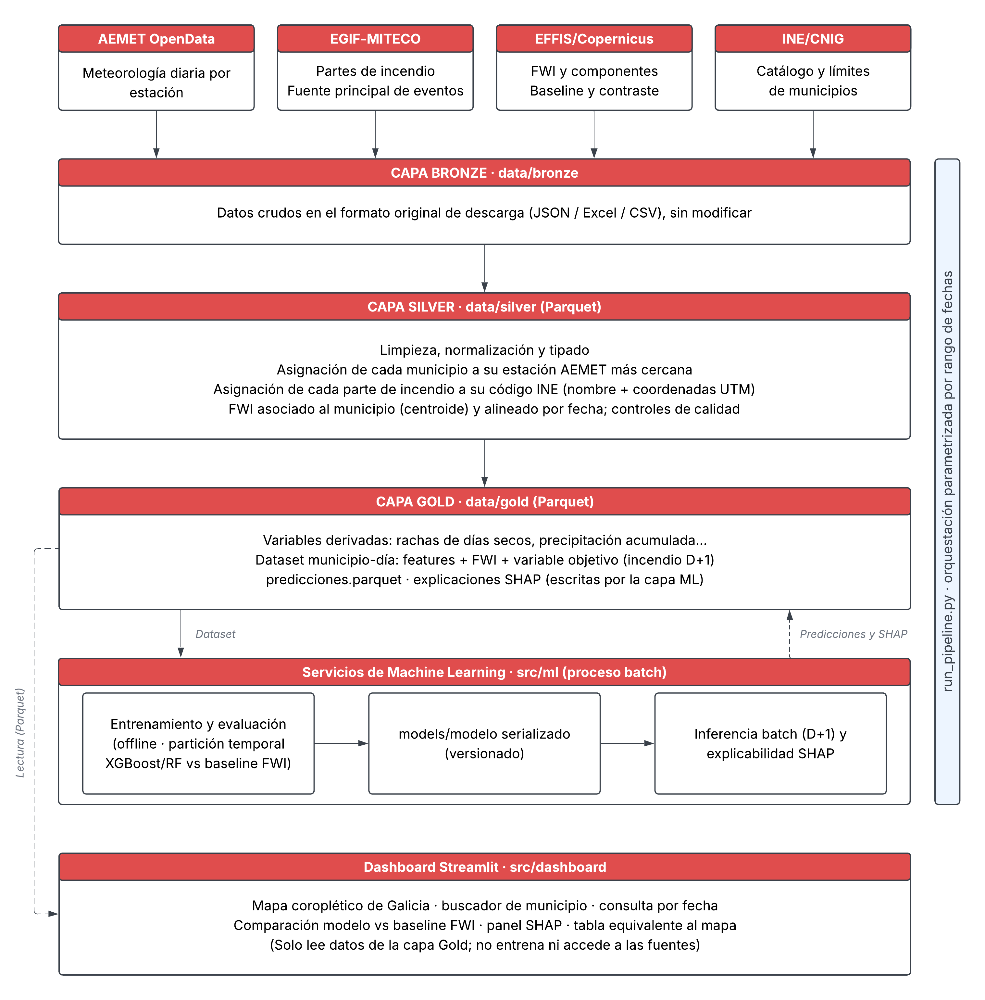

<p align="center"></p>

# Piriscope

**Sistema de estimación diaria de riesgo de incendio forestal por municipio**
Proyecto del módulo C088 · Proyecto de Inteligencia Artificial y Big Data · Grupo 6


---

## 📌 Descripción del proyecto

Los índices de riesgo de incendio forestal en uso, como el **FWI** (Fire Weather Index), se basan casi exclusivamente en variables meteorológicas y no incorporan el patrón histórico real de incendios de cada zona.

**Piriscope** es un sistema de predicción del riesgo relativo de incendio forestal para una región piloto (**Galicia**). Combina datos meteorológicos de **AEMET** con el histórico de incendios de **EGIF-MITECO** para entrenar un modelo supervisado (**XGBoost y/o Random Forest**) que estima, para cada municipio, la **probabilidad de incendio del día siguiente (D+1)** a partir de la información disponible hasta el día D.

El resultado:

- se categoriza en tres niveles de riesgo: **bajo, medio y alto**;
- se compara con el **FWI de EFFIS/Copernicus** como baseline;
- se explica con **SHAP**;
- se presenta en un **dashboard Streamlit** con mapa de Galicia, buscador de municipios, comparación frente al FWI y alternativa tabular al mapa.

### 🎯 Objetivo y criterio de éxito

Generar un pipeline reproducible que produzca predicciones diarias para **al menos el 80 % de los municipios gallegos**, usando **exclusivamente fuentes públicas**, y demostrar con métricas objetivas (**Recall** y **AUC-PR**) su comportamiento frente al baseline FWI.

### ⚠️ Qué no hace el sistema

Piriscope es una **herramienta experimental de apoyo**. No detecta incendios activos, no predice su propagación, no sustituye a los sistemas oficiales de protección civil y no garantiza que un incendio vaya a producirse. Sus resultados son estimaciones probabilísticas, no certezas.

---

## 👥 Integrantes

| Integrante | Rol principal |
|---|---|
| Cristina Puértolas Rebollar | Fuentes de datos, ingesta y coordinación general (Management) |
| Hikari Lheku Barrio Martín | Machine Learning y explicabilidad (ML) |
| Guillermo Ramón Serrano | Limpieza, normalización, tipado y cruce espacio-temporal (Data Engineering) |
| Alejandro Escolar Espejo | Presentación de resultados en el dashboard Streamlit (Frontend Dev) |

El reparto define la responsabilidad principal de cada persona; el equipo se apoya mutuamente ante bloqueos. El detalle está en la [documentación técnica](docs/NF2_Documentacion_y_Diseno_Tecnico.pdf).

---

## 🏗️ Arquitectura resumida

<p align="center"></p>

El sistema se organiza como un **pipeline de datos con arquitectura medallón** (Bronze → Silver → Gold), sobre el que se apoyan los servicios de Machine Learning (en proceso batch) y el dashboard.

| Capa / módulo | Qué hace |
|---|---|
| **Fuentes** | AEMET OpenData (meteorología diaria), EGIF-MITECO (partes de incendio), EFFIS/Copernicus (FWI y componentes), INE/CNIG (catálogo y límites municipales) |
| **Bronze** · `data/bronze` | Datos crudos en su formato original (JSON / Excel / CSV), archivados por fuente y fecha de ingesta, sin modificar |
| **Silver** · `data/silver` | Limpieza, normalización y tipado en Parquet. Cada municipio se asocia a su estación AEMET más cercana, cada incendio a su código INE y el FWI al centroide del municipio. Controles de calidad |
| **Gold** · `data/gold` | Variables derivadas (racha de días secos, precipitación acumulada…), dataset municipio-día con la variable objetivo, predicciones y explicaciones SHAP |
| **ML** · [`src/ml`](src/ml/README.md) | Entrenamiento offline con partición temporal y geográfica, modelo serializado y versionado en `models/`, inferencia batch D+1 y SHAP |
| **Dashboard** · `src/dashboard` | Streamlit. **Solo lee la capa Gold**: no entrena ni accede a las fuentes externas |

- **Orquestación:** un único punto de entrada, `run_pipeline.py`, parametrizable por rango de fechas, encadena ingesta → Silver → Gold → entrenamiento/inferencia.
- **Almacenamiento:** ficheros Parquet y CSV alojados en el dataset de Hugging Face [cpuertolas/piriscope](https://huggingface.co/datasets/cpuertolas/piriscope). No se usa base de datos en esta versión.
- **Ingesta automática:** workflows programados (cron) de GitHub Actions que suben los datos al dataset usando un token `HF_TOKEN` guardado en los Secrets del repositorio.
- **Despliegue monolítico:** frontend y backend en Streamlit, pero con la lógica separada en módulos de `src/` que solo se comunican mediante ficheros Parquet y el modelo serializado.

Más detalle en la [documentación y diseño técnico](docs/NF2_Documentacion_y_Diseno_Tecnico.pdf) y en el [registro de decisiones](docs/decisiones.md).

---

## ▶️ Cómo ejecutar

> 🚧 **El proyecto está en desarrollo.** La **ingesta de datos** ([`src/ingest`](src/ingest/README.md)), la **capa Silver** ([`src/silver`](src/silver/README.md)), la **capa Gold** ([`src/features`](src/features/README.md)) y los módulos de **ML y explicabilidad** ([`src/ml`](src/ml/README.md), [`src/explainability`](src/explainability/README.md)) ya están implementados y se ejecutan desde `run_pipeline.py`; los pasos marcados con ⏳ (el dashboard) aún no lo están.

### 1. Requisitos previos

- Python 3.x y Git
- Una **API key de AEMET OpenData** (gratuita): se solicita en [opendata.aemet.es](https://opendata.aemet.es/centrodedescargas/inicio)
- *(Solo para la ingesta automática)* un token de Hugging Face con permiso de escritura sobre el dataset

### 2. Clonar el repositorio e instalar el entorno

```bash
git clone https://github.com/cristinapuertolas-80/iFP-Piriscope.git
cd iFP-Piriscope

python -m venv .venv
source .venv/bin/activate          # En Windows: .venv\Scripts\activate

pip install -r environment/requirements.txt
```

### 3. Configurar las credenciales

Copia `.env.example` como `.env` en la raíz del proyecto (está excluido en `.gitignore`, **nunca lo subas**) y rellénalo:

```env
AEMET_API_KEY=tu_api_key_de_aemet
CDSAPI_KEY=tu_clave_del_early_warning_data_store   # FWI de EFFIS/Copernicus
HF_TOKEN=tu_token_de_hugging_face
```

### 4. Ingesta de datos

```bash
# Cada fuente por separado (detalle en src/ingest/README.md)
python -m src.ingest aemet --desde 2020-01-01 --hasta 2024-12-31
python -m src.ingest effis --desde 2020-01-01 --hasta 2024-12-31
python -m src.ingest egif          # exportaciones de EGIF en data/landing/egif/
python -m src.ingest ine_cnig      # límites del CNIG en data/landing/ine_cnig/

# O todas desde el orquestador, subiendo los originales a Hugging Face
python run_pipeline.py --desde 2020-01-01 --hasta 2024-12-31 --etapas ingesta --subir-hf
```

**Carga inicial** (histórico 2001–actualidad, una sola vez): `scripts/carga_inicial.sh` o `.\scripts\carga_inicial.ps1`.

La actualización periódica, **diaria para AEMET y semanal para el FWI**, la ejecuta el workflow [`.github/workflows/ingesta.yml`](.github/workflows/ingesta.yml), que necesita los Secrets `AEMET_API_KEY`, `HF_TOKEN` y, para el FWI, `CDSAPI_KEY`. Periodos, frecuencias y procedimiento completo: [docs/plan_ingesta.md](docs/plan_ingesta.md).

### 5. Capa Silver (limpieza, tipado y cruce espacio-temporal)

```bash
# Lee data/bronze (o los originales de Hugging Face con --descargar-hf) y escribe data/silver
python -m src.silver --descargar-hf
python -m src.silver --desde 2024-01-01 --hasta 2024-12-31   # reprocesa sólo ese periodo

# O desde el orquestador
python run_pipeline.py --desde 2001-01-01 --hasta 2024-12-31 --etapas silver
```

Tablas, cruce e informes de calidad: [src/silver/README.md](src/silver/README.md).

### 6. Capa Gold, modelo y predicciones

```bash
# Gold: variables derivadas y datasets municipio-día (src/features)
python run_pipeline.py --etapas gold

# Predicciones D+1 del último día disponible con el modelo v1 ya entrenado,
# más la verificación automática de las salidas
python run_pipeline.py --etapas ml

# Predecir un rango de días D concreto, empezando las salidas de cero y con figuras SHAP de ejemplo
python run_pipeline.py --etapas ml --inferir-desde 2024-01-02 --inferir-hasta 2026-10-21 \
    --reemplazar-predicciones --ejemplo-dir docs/resultados

# Reentrenar (HU-11): Gold, un modelo nuevo versionado y las predicciones con él
python run_pipeline.py --etapas gold ml --ml-acciones entrenar inferir --version-modelo v2
```

- `--desde` y `--hasta` delimitan la ingesta y Silver (solo son obligatorios para esas etapas). **Gold y ML trabajan sobre todo el histórico disponible**, y la inferencia predice el último día disponible salvo que se indique `--inferir-desde` y `--inferir-hasta`.
- El entrenamiento usa la configuración de DEC-47 (XGBoost, desde 2009, sin `viento`, `scale_pos_weight=1`, variantes `con_fwi` y `sin_fwi`) en la **fase de desarrollo**, que no toca el test. Se niega a sobrescribir una versión de modelo existente salvo con `--sobrescribir-modelo`.
- Las predicciones de los días sin FWI se hacen con el modelo de respaldo (`version_modelo = v1-respaldo`); detalle en [src/ml/README.md](src/ml/README.md).
- Si falla Silver, Gold o ML, el pipeline se detiene; `--continuar` lo evita. La ingesta no detiene el pipeline si falla una fuente, pero el código de salida es 1.
- Los modelos (`models/`) y los datos de `data/` no se suben al repositorio.

También se pueden ejecutar los módulos por separado: `python -m src.ml.inferir`, `python -m src.ml.experimento` y `python -m src.ml.walkforward` (opciones y ejemplos en [src/ml/README.md](src/ml/README.md)).

### 7. Lanzar el dashboard ⏳

El dashboard solo lee `predicciones.parquet` y `explicaciones.parquet` de Gold. El contrato de datos con ML está en [docs/contrato_dashboard_gold.md](docs/contrato_dashboard_gold.md).

```bash
streamlit run src/dashboard/app.py
```

### 8. Ejecutar los tests

```bash
pytest
```

Los tests también se ejecutan automáticamente con **GitHub Actions** en cada Pull Request.

---

## 📈 Resultados de la evaluación

Con el año de test (2023), el modelo con FWI supera al FWI en AUC-PR en los tres escenarios: municipios vistos (0,028 frente a 0,019), municipios no vistos (0,094 frente a 0,069) y no vistos en 2023 (0,038 frente a 0,021). El modelo sin FWI, que se usa como respaldo cuando falta el FWI, equivale al FWI. La ventaja es **modesta**, no se da en A Coruña, y la probabilidad está sobrestimada, por lo que se presenta como índice de riesgo. Tablas, intervalos y limitaciones: [docs/resultados](docs/resultados/README.md) y [src/ml/README.md](src/ml/README.md).

---

## 🛠️ Tecnologías

| Categoría | Tecnología | Motivo |
|---|---|---|
| Lenguaje | **Python** | Amplio ecosistema para datos, ML y visualización |
| Procesamiento de datos | **pandas** | Suficiente para el volumen previsto (~1,7–3 M filas municipio-día); PySpark solo si se justifica |
| Modelado | **XGBoost / Random Forest** | Adecuados para datos tabulares y relaciones no lineales |
| Explicabilidad | **SHAP** | Contribución de cada variable en modelos basados en árboles |
| Visualización | **Streamlit** | Dashboard funcional rápido a partir de predicciones precalculadas |
| Geoespacial y mapas | **GeoPandas + Plotly** | Cruce espacial y mapa coroplético sin servidor de mapas |
| Almacenamiento | **Parquet / CSV · Hugging Face Datasets** | Ligero y suficiente para el prototipo |
| Pruebas e integración | **pytest + GitHub Actions** | Tests automáticos en cada Pull Request |
| Control de versiones | **Git / GitHub** | Ramas, Pull Requests, issues y [tablero Kanban](https://github.com/users/cristinapuertolas-80/projects/1/views/1) |

---

## 📁 Estructura del repositorio

```
repo/
├── docs/                                  # Documentación del proyecto
│   ├── NF1_Presentacion_y_Viabilidad.pdf
│   ├── NF2_Documentacion_y_Diseno_Tecnico.pdf
│   ├── arquitectura.png                   # Diagrama de arquitectura
│   ├── municipios_reservados.csv          # Municipios reservados para evaluación geográfica
│   ├── tabla_equivalencias.csv            # Equivalencias de códigos INE históricos
│   ├── decisiones.md                      # Registro de decisiones técnicas
│   ├── contrato_dashboard_gold.md         # Contrato de datos entre ML y dashboard (capa Gold)
│   └── resultados/                        # Informes de evaluación (final y walk-forward)
│
├── src/                                   # Código fuente
│   ├── ingest/                            # Descarga e ingesta de las fuentes (Bronze)
│   ├── silver/                            # Limpieza, tipado y cruce espacio-temporal (Silver)
│   ├── features/                          # Variables derivadas y dataset final (Gold)
│   ├── ml/                                # Entrenamiento, evaluación e inferencia
│   ├── explainability/                    # Explicaciones SHAP
│   └── dashboard/                         # Aplicación Streamlit
│
├── data/                                  # Datos (no versionados, solo .gitkeep)
│   ├── bronze/                            # Datos crudos originales
│   ├── silver/                            # Datos limpios en Parquet
│   └── gold/                              # Dataset final, predicciones y SHAP
│
├── models/                                # Modelos serializados y versionados
├── scripts/                               # Carga inicial de datos (.sh y .ps1)
├── environment/                           # Configuración del entorno
├── README.md
├── CONTRIBUTING.md
└── .gitignore
```

Los datos de `data/` no se suben al repositorio por su tamaño; se obtienen ejecutando el pipeline o desde el dataset de Hugging Face.

---

## 📄 Documentación

- [NF1 · Presentación y viabilidad](docs/NF1_Presentacion_y_Viabilidad.pdf)
- [NF2 · Documentación y diseño técnico](docs/NF2_Documentacion_y_Diseno_Tecnico.pdf)
- [Plan de ingesta de datos](docs/plan_ingesta.md)
- [Decisiones de diseño](docs/decisiones.md)
- [Contrato de datos entre ML y dashboard](docs/contrato_dashboard_gold.md)
- [Guía de contribución](CONTRIBUTING.md) (flujo Git, ramas `feat/`, `fix/`, `docs/`, `chore/` y Pull Requests con squash a `main`)

---

## ⚖️ Fuentes de datos y licencias

Todas las fuentes son públicas, gratuitas y con datos reales (no se generan datos sintéticos).

| Fuente | Uso en el proyecto | Condiciones y atribución |
|---|---|---|
| [AEMET OpenData](https://opendata.aemet.es/centrodedescargas/inicio) | Meteorología diaria por estación | Reutilizable según la nota legal de AEMET (Ley 37/2007, mod. Ley 18/2015). **Fuente: AEMET.** AEMET no respalda este trabajo |
| [EGIF-MITECO](https://www.miteco.gob.es/es/biodiversidad/temas/incendios-forestales/estadisticas-datos.html) | Histórico de partes de incendio (fuente principal de eventos) | Ley 37/2007 y RD 1495/2011; CC BY 4.0 en datos.gob.es. **Origen de los datos: Ministerio para la Transición Ecológica y el Reto Demográfico** |
| [EFFIS / Copernicus](https://forest-fire.emergency.copernicus.eu/applications/data-and-services) | FWI y componentes (variable y baseline) | CC BY 4.0 ([licencia](https://forest-fire.emergency.copernicus.eu/about-effis/data-license)). Copernicus Emergency Management Service (JRC); FWI histórico DOI 10.24381/cds.0e89c522 (ECMWF). Los datos se han transformado |
| [INE](https://www.ine.es/dynt3/metadatos/RespuestaDatos.html?oper=185) | Códigos y nombres oficiales de municipios | **Elaboración propia con datos extraídos del sitio web del INE: www.ine.es** |
| [CNIG / IGN](https://centrodedescargas.cnig.es/CentroDescargas/index.jsp) | Límites municipales | Licencia compatible con CC BY 4.0 (Orden FOM/2807/2015). **© Instituto Geográfico Nacional** |

El proyecto no trata datos personales: la información se agrega a nivel de municipio y día y solo se conservan los campos necesarios.
