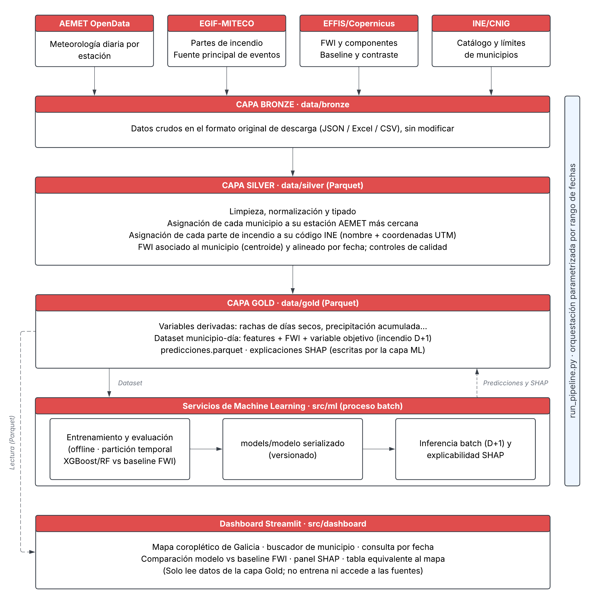

<p align="center"></p>

# Piriscope

**Sistema de estimación diaria de riesgo de incendio forestal por municipio**
Proyecto del módulo C088 · Proyecto de Inteligencia Artificial y Big Data · Grupo 6


-blue)
[](https://github.com/cristinapuertolas-80/iFP-Piriscope/actions/workflows/tests.yml)

---

## 📌 Descripción del proyecto

Los índices de riesgo de incendio forestal en uso, como el **FWI** (Fire Weather Index), se basan casi exclusivamente en variables meteorológicas y no incorporan el patrón histórico real de incendios de cada zona.

**Piriscope** es un sistema de predicción del riesgo relativo de incendio forestal para una región piloto (**Galicia**). Combina datos meteorológicos de **AEMET** con el histórico de incendios de **EGIF-MITECO** para entrenar un modelo supervisado (**XGBoost y/o Random Forest**) que estima, para cada municipio, la **probabilidad de incendio del día siguiente (D+1)** a partir de la información disponible hasta el día D.

El resultado:

- se categoriza en tres niveles de riesgo: **bajo, medio y alto**;
- se compara con el **FWI de EFFIS/Copernicus** como baseline;
- se explica con **SHAP**;
- se presenta en un **dashboard Streamlit** con mapa de Galicia, buscador de municipios, comparación frente al FWI y alternativa tabular al mapa.

### 🎯 Objetivo y criterio de éxito

Generar un pipeline reproducible que produzca predicciones diarias para **al menos el 80 % de los municipios gallegos**, usando **exclusivamente fuentes públicas**, y demostrar con métricas objetivas (**Recall** y **AUC-PR**) su comportamiento frente al baseline FWI.

### ⚠️ Qué no hace el sistema

Piriscope es una **herramienta experimental de apoyo**. No detecta incendios activos, no predice su propagación, no sustituye a los sistemas oficiales de protección civil y no garantiza que un incendio vaya a producirse. Sus resultados son estimaciones probabilísticas, no certezas.

---

## 👥 Integrantes

| Integrante | Rol principal |
|---|---|
| Cristina Puértolas Rebollar | Fuentes de datos, ingesta y coordinación general (Management) |
| Hikari Lheku Barrio Martín | Machine Learning y explicabilidad (ML) |
| Guillermo Ramón Serrano | Limpieza, normalización, tipado y cruce espacio-temporal (Data Engineering) |
| Alejandro Escolar Espejo | Presentación de resultados en el dashboard Streamlit (Frontend Dev) |

El reparto define la responsabilidad principal de cada persona; el equipo se apoya mutuamente ante bloqueos. El detalle está en la [documentación técnica](docs/NF2_Documentacion_y_Diseno_Tecnico.pdf).

---

## 🏗️ Arquitectura resumida

<p align="center"></p>

El sistema se organiza como un **pipeline de datos con arquitectura medallón** (Bronze → Silver → Gold), sobre el que se apoyan los servicios de Machine Learning (en proceso batch) y el dashboard.

| Capa / módulo | Qué hace |
|---|---|
| **Fuentes** | AEMET OpenData (meteorología diaria), EGIF-MITECO (partes de incendio), EFFIS/Copernicus (FWI y componentes), INE/CNIG (catálogo y límites municipales) |
| **Bronze** · `data/bronze` | Datos crudos en su formato original (JSON / Excel / CSV), archivados por fuente y fecha de ingesta, sin modificar |
| **Silver** · `data/silver` | Limpieza, normalización y tipado en Parquet. Cada municipio se asocia a su estación AEMET más cercana, cada incendio a su código INE y el FWI al centroide del municipio. Controles de calidad |
| **Gold** · `data/gold` | Variables derivadas (racha de días secos, precipitación acumulada…), dataset municipio-día con la variable objetivo, predicciones y explicaciones SHAP |
| **ML** · [`src/ml`](src/ml/README.md) | Entrenamiento offline con partición temporal y geográfica, modelo serializado y versionado en `models/`, inferencia batch D+1 y SHAP |
| **Dashboard** · `src/dashboard` | Streamlit. **Solo lee la capa Gold**: no entrena ni accede a las fuentes externas |

- **Orquestación:** un único punto de entrada, `run_pipeline.py`, parametrizable por rango de fechas, encadena ingesta → Silver → Gold → entrenamiento/inferencia.
- **Almacenamiento:** ficheros Parquet y CSV alojados en el dataset de Hugging Face [cpuertolas/piriscope](https://huggingface.co/datasets/cpuertolas/piriscope). No se usa base de datos en esta versión.
- **Ingesta automática:** workflows programados (cron) de GitHub Actions que suben los datos al dataset usando un token `HF_TOKEN` guardado en los Secrets del repositorio.
- **Despliegue monolítico:** frontend y backend en Streamlit, pero con la lógica separada en módulos de `src/` que solo se comunican mediante ficheros Parquet y el modelo serializado.

El diagrama anterior es el del diseño (NF2). La arquitectura **tal como está implementada** (módulos, comandos, ficheros intermedios, Hugging Face y workflows) está en [docs/arquitectura_implementada.png](docs/arquitectura_implementada.png).

Más detalle en la [documentación y diseño técnico](docs/NF2_Documentacion_y_Diseno_Tecnico.pdf) y en el [registro de decisiones](docs/decisiones.md).

---

## ▶️ Cómo ejecutar

> ✅ **Producto funcional en local (NF3).** La **ingesta de datos** ([`src/ingest`](src/ingest/README.md)), la **capa Silver** ([`src/silver`](src/silver/README.md)), la **capa Gold** ([`src/features`](src/features/README.md)) y los módulos de **ML y explicabilidad** ([`src/ml`](src/ml/README.md), [`src/explainability`](src/explainability/README.md)) ya están implementados y se ejecutan desde `run_pipeline.py`. El **dashboard** ([`src/dashboard`](src/dashboard/README.md)) se lanza con Streamlit. Lo que falta para NF4 está en [Limitaciones y pendientes](#-limitaciones-y-pendientes).

### 1. Requisitos previos

- Python **3.12** (probado; vale ≥ 3.10) y Git
- Una cuenta de **Hugging Face** con acceso aceptado al dataset [cpuertolas/piriscope](https://huggingface.co/datasets/cpuertolas/piriscope) (es de acceso restringido) y un token de **lectura**. Con eso basta para ejecutar todo desde los datos archivados, sin claves de las fuentes
- *(Solo para descargar datos nuevos de las fuentes)* una **API key de AEMET OpenData** (gratuita): se solicita en [opendata.aemet.es](https://opendata.aemet.es/centrodedescargas/inicio)
- *(Solo para la ingesta automática)* un token de Hugging Face con permiso de escritura sobre el dataset

### 2. Clonar el repositorio e instalar el entorno

```bash
git clone https://github.com/cristinapuertolas-80/iFP-Piriscope.git
cd iFP-Piriscope

python -m venv .venv
source .venv/bin/activate          # En Windows: .venv\Scripts\activate

pip install -r environment/requirements-lock.txt   # versiones exactas probadas (recomendado)
# o, con rangos de versiones: pip install -r environment/requirements.txt
```

`environment/requirements-lock.txt` fija las versiones exactas con las que pasan los tests y se generan las evidencias (Python 3.12). `requirements.txt` declara los rangos mínimos y `requirements-dashboard.txt`, solo lo necesario para el dashboard.

### 3. Configurar las credenciales

Copia `.env.example` como `.env` en la raíz del proyecto (está excluido en `.gitignore`, **nunca lo subas**) y rellénalo:

```env
AEMET_API_KEY=tu_api_key_de_aemet
CDSAPI_KEY=tu_clave_del_early_warning_data_store   # FWI de EFFIS/Copernicus
HF_TOKEN=tu_token_de_hugging_face
```

### 4. Ingesta de datos

```bash
# Cada fuente por separado (detalle en src/ingest/README.md)
python -m src.ingest aemet --desde 2020-01-01 --hasta 2024-12-31
python -m src.ingest effis --desde 2020-01-01 --hasta 2024-12-31
python -m src.ingest egif          # exportaciones de EGIF en data/landing/egif/
python -m src.ingest ine_cnig      # límites del CNIG en data/landing/ine_cnig/

# O todas desde el orquestador, subiendo los originales a Hugging Face
python run_pipeline.py --desde 2020-01-01 --hasta 2024-12-31 --etapas ingesta --subir-hf
```

**Carga inicial** (histórico 2001–actualidad, una sola vez): `scripts/carga_inicial.sh` o `.\scripts\carga_inicial.ps1`.

La actualización periódica, **diaria para AEMET y semanal para el FWI**, la ejecuta el workflow [`.github/workflows/ingesta.yml`](.github/workflows/ingesta.yml), que necesita los Secrets `AEMET_API_KEY`, `HF_TOKEN` y, para el FWI, `CDSAPI_KEY`. Periodos, frecuencias y procedimiento completo: [docs/plan_ingesta.md](docs/plan_ingesta.md).

### 5. Capa Silver (limpieza, tipado y cruce espacio-temporal)

```bash
# Lee data/bronze (o los originales de Hugging Face con --descargar-hf) y escribe data/silver
python -m src.silver --descargar-hf
python -m src.silver --desde 2024-01-01 --hasta 2024-12-31   # reprocesa sólo ese periodo

# O desde el orquestador
python run_pipeline.py --desde 2001-01-01 --hasta 2024-12-31 --etapas silver
```

Tablas, cruce e informes de calidad: [src/silver/README.md](src/silver/README.md).

### 6. Capa Gold, modelo y predicciones

```bash
# Gold: variables derivadas y datasets municipio-día (src/features)
python run_pipeline.py --etapas gold

# Predicciones D+1 del último día disponible con el modelo v1 ya entrenado,
# más la verificación automática de las salidas
python run_pipeline.py --etapas ml

# Predecir un rango de días D concreto, empezando las salidas de cero y con figuras SHAP de ejemplo
python run_pipeline.py --etapas ml --inferir-desde 2024-01-02 --inferir-hasta 2026-10-21 \
    --reemplazar-predicciones --ejemplo-dir docs/resultados

# Reentrenar (HU-11): Gold, un modelo nuevo versionado y las predicciones con él
python run_pipeline.py --etapas gold ml --ml-acciones entrenar inferir --version-modelo v2
```

- `--desde` y `--hasta` delimitan la ingesta y Silver (solo son obligatorios para esas etapas). **Gold y ML trabajan sobre todo el histórico disponible**, y la inferencia predice el último día disponible salvo que se indique `--inferir-desde` y `--inferir-hasta`.
- El entrenamiento usa la configuración de DEC-47 (XGBoost, desde 2009, sin `viento`, `scale_pos_weight=1`, variantes `con_fwi` y `sin_fwi`) en la **fase de desarrollo**, que no toca el test. Se niega a sobrescribir una versión de modelo existente salvo con `--sobrescribir-modelo`.
- Las predicciones de los días sin FWI se hacen con el modelo de respaldo (`version_modelo = v1-respaldo`); detalle en [src/ml/README.md](src/ml/README.md).
- Con `--subir-hf`, tras inferir y verificar se publican las predicciones y las explicaciones en el dataset de Hugging Face (`data/gold/`), de donde las descarga el dashboard. Hace falta un token con permiso de escritura; `python -m src.ml.hf_hub --dry-run` comprueba sin subir.
- Si falla Silver, Gold o ML, el pipeline se detiene; `--continuar` lo evita. La ingesta no detiene el pipeline si falla una fuente, pero el código de salida es 1.
- Los modelos (`models/`) y los datos de `data/` no se suben al repositorio.

También se pueden ejecutar los módulos por separado: `python -m src.ml.inferir`, `python -m src.ml.experimento` y `python -m src.ml.walkforward` (opciones y ejemplos en [src/ml/README.md](src/ml/README.md)).

### 6 bis. Reproducir todo el pipeline desde los datos archivados (sin claves de las fuentes)

Los originales de cada ingesta están archivados en `raw/` del dataset de Hugging Face y los modelos versionados en `models/`, así que el producto completo se puede levantar desde cero solo con el token de lectura en `.env` (`HF_TOKEN=...`). En este orden:

```bash
python -m src.silver --descargar-hf                       # 1. Bronze archivado (raw/) -> Silver   (~7 min)
python run_pipeline.py --etapas gold                      # 2. Silver -> Gold                      (~10 s)
python run_pipeline.py --etapas ml --descargar-modelos \
       --inferir-desde 2026-10-01                         # 3. modelo v1 -> predicciones D+1, SHAP y verificación (~15 s)
python run_dashboard.py --local                           # 4. dashboard sobre la Gold generada (http://localhost:8501)
```

- El paso 3 baja `models/v1_*` de Hugging Face (`python -m src.ml.modelos_hf`), predice desde la fecha indicada hasta el último día con datos y ejecuta `scripts/verificar_salidas.py`; si alguna comprobación falla, el pipeline termina con error.
- Sin `--inferir-desde` predice solo el último día. Para escribir las predicciones nuevas sobre las publicadas, copia antes a `data/gold/` los `predicciones.parquet` y `explicaciones.parquet` del dataset (es lo que hace el workflow de evidencias).
- Duraciones medidas en un runner estándar de GitHub Actions (`ubuntu-latest`); la memoria máxima fue de ~2,8 GB en Gold.
- `python scripts/comparar_predicciones.py --referencia <publicadas> --nuevo data/gold/predicciones.parquet` comprueba que las predicciones regeneradas coinciden con las publicadas.

El workflow [`evidencias.yml`](.github/workflows/evidencias.yml) ejecuta exactamente estos pasos en una máquina limpia, arranca el dashboard, comprueba que responde, lo captura y publica el resultado en la rama [`evidencias/nf3`](https://github.com/cristinapuertolas-80/iFP-Piriscope/tree/evidencias/nf3).

### 7. Lanzar el dashboard

Para solo ver el dashboard **no hace falta ningún paso anterior**: basta con clonar el repositorio y ejecutar

```bash
python run_dashboard.py
```

La primera vez crea `.venv` (o usa el entorno activo), instala solo las librerías del dashboard, pide un token de lectura de Hugging Face y lo guarda en `.env`, y comprueba el acceso al dataset; si tu cuenta aún no lo tiene, te dice dónde aceptarlo. Después abre el dashboard en el navegador. Las siguientes veces solo lo abre. Opciones: `--cambiar-token`, `--local` (usa `data/gold/` en lugar de Hugging Face) y `--solo-preparar`.

El dashboard solo lee `predicciones.parquet` y `explicaciones.parquet` de Gold, que descarga del dataset de Hugging Face (sin conexión usa `data/gold/`). Con el entorno ya preparado también se puede lanzar con `streamlit run src/dashboard/app.py`. El contrato de datos con ML está en [docs/contrato_dashboard_gold.md](docs/contrato_dashboard_gold.md) y el detalle del dashboard en [src/dashboard/README.md](src/dashboard/README.md).

### 8. Ejecutar los tests

```bash
pytest
```

Los tests también se ejecutan automáticamente con **GitHub Actions** en cada Pull Request y en `main` ([`tests.yml`](.github/workflows/tests.yml)), con las versiones del lockfile, y guardan el informe JUnit. No necesitan red ni datos reales: usan datos de juguete con el esquema de cada capa y dobles de las APIs. Las comprobaciones sobre los datos reales (validación de Silver, `verificar_salidas.py`, reproducibilidad de las predicciones) se ejecutan en [`evidencias.yml`](.github/workflows/evidencias.yml).

---

## 🚧 Limitaciones y pendientes

Estado a la entrega de NF3. El detalle de cada punto está en [docs/decisiones.md](docs/decisiones.md) (sección *Decisiones pendientes*) y en [src/ml/README.md](src/ml/README.md).

- **Las predicciones no se actualizan solas.** La ingesta es automática (cron), pero Silver, Gold, inferencia y publicación se lanzan a mano con `run_pipeline.py` (`--subir-hf` publica también la Gold tras inferir y verificar, DEC-53). El dashboard muestra la última fecha publicada, no la de hoy.
- **Publicación en Hugging Face sin probar contra el dataset real**: `python -m src.ml.hf_hub` (Gold) y `python -m src.ml.modelos_hf --subir` (modelos) están cubiertos por tests con un cliente simulado y sus comprobaciones previas se ejecutan sobre los ficheros reales con `--dry-run` en el workflow de evidencias, pero aún no se ha hecho una subida real con ellos.
- **El FWI llega con retraso**: los últimos días se predicen con el modelo de respaldo (sin FWI), que no mejora al FWI y discrimina poco (pocos valores distintos por día).
- **Rendimiento modesto** frente al FWI, un solo año de test, **A Coruña no mejora** al FWI y la probabilidad no está calibrada (se presenta como índice de riesgo). Política de niveles provisional (DEC-49): en sequía casi todos los municipios quedan en «medio» o «alto».
- **Cobertura**: ~25 municipios sin ninguna variable meteorológica en los días recientes aparecen como «Sin dato» (cobertura ≥ 80 % en todas las fechas). El viento se excluyó por tener ~57 % de nulos.
- **Fuentes con paso manual**: las exportaciones de EGIF y los recintos del CNIG se dejan en `data/landing/`; la ingesta de AEMET y del FWI necesita sus claves.
- **Pendiente de verificar con datos reales**: el reentrenamiento reproducible (`--ml-acciones entrenar`), comparar el FWI intermedio con el consolidado y contrastar las etiquetas de 2022-2023 con las estadísticas definitivas de EGIF.
- **El dataset de Hugging Face es de acceso restringido**: reproducir requiere una cuenta con acceso aceptado.
- **Detalles de interfaz**: en la tabla del día, las celdas sin valor (FWI de las estimaciones sin FWI, municipios sin dato) aparecen como «None», que es como `st.dataframe` pinta los nulos; y en la explicación SHAP el título del eje horizontal se corta en algunos anchos de pantalla.

---

## 📈 Resultados de la evaluación

Con el año de test (2023), el modelo con FWI supera al FWI en AUC-PR en los tres escenarios: municipios vistos (0,028 frente a 0,019), municipios no vistos (0,093 frente a 0,069) y no vistos en 2023 (0,038 frente a 0,021). El modelo sin FWI, que se usa como respaldo cuando falta el FWI, equivale al FWI. La ventaja es **modesta**, no se da en A Coruña, y la probabilidad está sobrestimada, por lo que se presenta como índice de riesgo. Tablas, intervalos y limitaciones: [docs/resultados](docs/resultados/README.md) y [src/ml/README.md](src/ml/README.md).

---

## 🛠️ Tecnologías

| Categoría | Tecnología | Motivo |
|---|---|---|
| Lenguaje | **Python** | Amplio ecosistema para datos, ML y visualización |
| Procesamiento de datos | **pandas** | Suficiente para el volumen previsto (~1,7–3 M filas municipio-día); PySpark solo si se justifica |
| Modelado | **XGBoost / Random Forest** | Adecuados para datos tabulares y relaciones no lineales |
| Explicabilidad | **SHAP** | Contribución de cada variable en modelos basados en árboles |
| Visualización | **Streamlit** | Dashboard funcional rápido a partir de predicciones precalculadas |
| Geoespacial y mapas | **GeoPandas + Plotly** | Cruce espacial y mapa coroplético sin servidor de mapas |
| Almacenamiento | **Parquet / CSV · Hugging Face Datasets** | Ligero y suficiente para el prototipo |
| Pruebas e integración | **pytest + GitHub Actions** | Tests automáticos en cada Pull Request |
| Control de versiones | **Git / GitHub** | Ramas, Pull Requests, issues y [tablero Kanban](https://github.com/users/cristinapuertolas-80/projects/1/views/1) |

---

## 📁 Estructura del repositorio

Estructura real del repositorio (se omiten los `__init__.py`). Los módulos de `src/` solo se comunican mediante ficheros Parquet de `data/` y los modelos de `models/`.

```
iFP-Piriscope/
├── run_pipeline.py                 # Orquestador único: ingesta → Silver → Gold → ML (entrenar / inferir / verificar)
├── run_dashboard.py                # Lanzador del dashboard en un comando (entorno, token de HF, arranque)
├── pytest.ini · .env.example · .gitignore · .gitattributes · README.md · CONTRIBUTING.md
│
├── src/
│   ├── ingest/                     # Bronze: descarga de las fuentes y archivo en Hugging Face
│   │   ├── cli.py · __main__.py    #   python -m src.ingest <fuente>
│   │   ├── aemet.py · effis.py · egif.py · ine_cnig.py   # un módulo por fuente
│   │   ├── common.py · config.py   #   manifiestos, reintentos, errores de red, configuración (.env)
│   │   └── hf_hub.py               #   subida/descarga de raw/<FUENTE>/<timestamp>
│   ├── silver/                     # Silver: limpieza, tipado y cruce espacio-temporal (Parquet)
│   │   ├── pipeline.py · __main__.py            # python -m src.silver
│   │   ├── municipios.py · meteo.py · fwi.py · incendios.py   # una tabla por entidad del modelo de datos
│   │   ├── geo.py · fuentes.py · almacen.py     #   utilidades geoespaciales, lectura de Bronze, escritura
│   │   ├── calidad.py · validacion.py · muestra_validacion.py   # controles de calidad y validación
│   │   └── hf_hub.py
│   ├── features/                   # Gold: variables derivadas y datasets municipio-día
│   │   ├── derived.py · dataset.py · __main__.py   # python -m src.features
│   ├── ml/                         # Entrenamiento, evaluación, inferencia batch D+1
│   │   ├── config.py · splits.py · train.py · evaluate.py · risk.py · predict.py
│   │   ├── experimento.py · walkforward.py · reservados.py
│   │   ├── inferir.py              #   inferencia con modelo principal y de respaldo + SHAP
│   │   ├── hf_hub.py               #   publicación de predicciones y explicaciones de Gold en Hugging Face
│   │   └── modelos_hf.py           #   descarga y publicación de los modelos versionados en Hugging Face
│   ├── explainability/             # SHAP: valores, top-5 por predicción, gráficos
│   │   └── config.py · shap_explain.py · plots.py
│   └── dashboard/                  # Streamlit: solo lee Gold
│       ├── app.py · datos.py · graficos.py
│       └── assets/municipios_galicia.geojson
│
├── tests/                          # pytest (sin red ni datos reales: datos de juguete y dobles)
├── scripts/                        # Carga inicial (.sh/.ps1), verificación y análisis auxiliares, capturas
├── environment/                    # requirements.txt · requirements-lock.txt · requirements-dashboard.txt
├── docs/                           # NF1, NF2, arquitectura, decisiones, contrato Gold, resultados
│   └── resultados/                 #   informes de evaluación, SHAP global y ejemplos
├── .github/workflows/              # tests.yml (cada PR) · ingesta.yml (cron) · evidencias.yml (NF3)
├── data/{bronze,silver,gold}/      # Datos (no versionados: solo .gitkeep; viven en Hugging Face)
└── models/                         # Modelos serializados (no versionados: viven en Hugging Face)
```

Cada carpeta de `src/` tiene su propio README con el detalle de sus módulos. Los datos de `data/` y los modelos de `models/` no se suben a GitHub por su tamaño: están en el dataset de Hugging Face [cpuertolas/piriscope](https://huggingface.co/datasets/cpuertolas/piriscope) (`raw/`, `data/silver/`, `data/gold/`, `models/`) y se obtienen ejecutando el pipeline o descargándolos.

---

## 📄 Documentación

- [NF1 · Presentación y viabilidad](docs/NF1_Presentacion_y_Viabilidad.pdf)
- [NF2 · Documentación y diseño técnico](docs/NF2_Documentacion_y_Diseno_Tecnico.pdf)
- [Plan de ingesta de datos](docs/plan_ingesta.md)
- [Decisiones de diseño](docs/decisiones.md)
- [Contrato de datos entre ML y dashboard](docs/contrato_dashboard_gold.md)
- [Guía de contribución](CONTRIBUTING.md) (flujo Git, ramas `feat/`, `fix/`, `docs/`, `chore/` y Pull Requests con squash a `main`)

---

## ⚖️ Fuentes de datos y licencias

Todas las fuentes son públicas, gratuitas y con datos reales (no se generan datos sintéticos).

| Fuente | Uso en el proyecto | Condiciones y atribución |
|---|---|---|
| [AEMET OpenData](https://opendata.aemet.es/centrodedescargas/inicio) | Meteorología diaria por estación | Reutilizable según la nota legal de AEMET (Ley 37/2007, mod. Ley 18/2015). **Fuente: AEMET.** AEMET no respalda este trabajo |
| [EGIF-MITECO](https://www.miteco.gob.es/es/biodiversidad/temas/incendios-forestales/estadisticas-datos.html) | Histórico de partes de incendio (fuente principal de eventos) | Ley 37/2007 y RD 1495/2011; CC BY 4.0 en datos.gob.es. **Origen de los datos: Ministerio para la Transición Ecológica y el Reto Demográfico** |
| [EFFIS / Copernicus](https://forest-fire.emergency.copernicus.eu/applications/data-and-services) | FWI y componentes (variable y baseline) | CC BY 4.0 ([licencia](https://forest-fire.emergency.copernicus.eu/about-effis/data-license)). Copernicus Emergency Management Service (JRC); FWI histórico DOI 10.24381/cds.0e89c522 (ECMWF). Los datos se han transformado |
| [INE](https://www.ine.es/dynt3/metadatos/RespuestaDatos.html?oper=185) | Códigos y nombres oficiales de municipios | **Elaboración propia con datos extraídos del sitio web del INE: www.ine.es** |
| [CNIG / IGN](https://centrodedescargas.cnig.es/CentroDescargas/index.jsp) | Límites municipales | Licencia compatible con CC BY 4.0 (Orden FOM/2807/2015). **© Instituto Geográfico Nacional** |

El proyecto no trata datos personales: la información se agrega a nivel de municipio y día y solo se conservan los campos necesarios.
